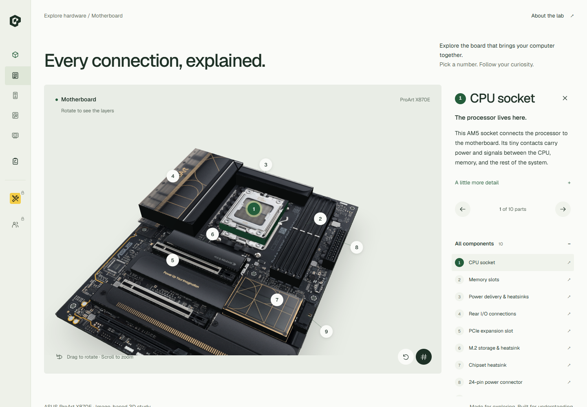

<p align="center">
  
</p>

<h1 align="center">Meet the hardware behind the screen.</h1>

<p align="center">
  An interactive 3D learning lab for understanding your computer.<br>
  Rotate it. Explore it. Put your knowledge to the test.
</p>

<p align="center">
  <a href="#take-a-look-inside">Explore the features</a> ·
  <a href="#run-it-yourself">Run locally</a> ·
  <a href="#coming-next">What’s next</a>
</p>

---

## What is 3DHV?

Ever looked inside a computer and wondered, “What does that bit do?”

**3DHV turns computer hardware into something you can explore.** Rotate a 3D model, select a numbered component, and learn its purpose, connections and practical details. Then head into Test mode to see what stuck.

It’s built for curious beginners, students, aspiring PC builders and anyone who wants to connect the names of components with what they actually do. No screwdriver required.

## Take a look inside

| Explore | What you’ll discover |
| --- | --- |
| **Motherboard** | CPU socket, memory slots, PCIe, power connections, storage interfaces and more, using a layered model based on a real motherboard photograph. |
| **PC tower** | Switch between **Front**, **Rear** and **Inside** views to find buttons, ports, cooling and internal parts. |
| **Hard disk** | Open the enclosure and explore the components inside a mechanical drive. |
| **Solid-state drive** | Look inside a SATA SSD and understand its storage components. |

Select a number to bring a component into focus. Read the short explanation first, then open the extra detail when you want to go deeper.

### A little less guessing. A lot more understanding.

The separate **Test mode** includes **64 questions across eight topics**, from foundations to advanced concepts:

- Motherboard
- CPU & memory
- Storage
- Ports & connections
- Power & cooling
- Assembly & firmware
- Performance
- Data & reliability

Choose your topics, difficulty and session length, then pick how you want to learn:

| Mode | How it works |
| --- | --- |
| **Practice** | Get feedback and an explanation after each answer. |
| **Assessment** | Complete the session before seeing your score and explanations. |

Questions come in **six formats**: single choice, multiple selection, true or false, matching, ordered steps and identification on a motherboard photo. Results show your score by topic, with an option to retry missed questions.

Each fully correct answer earns one point; there’s no partial credit. Sessions currently reset when you leave the page. The bank supports learning and revision; it isn’t a professional certification.

### Made for a mouse. Ready for a thumb.

- **Desktop:** an icon sidebar expands on hover or keyboard focus.
- **Phones and tablets:** a menu drawer gives the content room to breathe.
- **3D controls:** drag to rotate, scroll or pinch to zoom, and reset the view whenever you need.
- **Accessible interactions:** visible keyboard focus, labeled controls, reduced-motion support and a component list alongside the 3D view.

## Your first five minutes

1. **Choose a piece of hardware.** The motherboard is a good starting point.
2. **Pick a number.** Follow the component into focus and read what it does.
3. **Try another view.** The tower’s front and rear panels are a great way to learn everyday connections.
4. **Start a practice session.** Choose a topic you’ve just explored.
5. **Revisit what you missed.** Explanations make mistakes part of the lesson.

## Run it yourself

Use **Node.js 24** and npm. This also supports the standalone question-bank check, which imports its TypeScript data module directly.

```bash
git clone https://github.com/KarmSorathiya378/3d-hardware-tutorials.git
cd 3d-hardware-tutorials
npm ci
npm run dev
```

Open **[localhost:3000](http://localhost:3000)** in your browser.

| Command | Purpose |
| --- | --- |
| `npm run dev` | Start the local development server. |
| `npm run build` | Create the production build and run TypeScript checks. |
| `npm start` | Serve the production build after building it. |
| `npm run lint` | Run ESLint. |
| `node scripts/test-learning.mjs` | Validate the question bank, grading and session generation. |

The core explorer and tests don’t need API keys. A WebGL-capable browser is needed for the 3D models; the component list also provides access to the explanations.

## Under the hood

Built with **Next.js, React, TypeScript, Three.js, React Three Fiber and Drei**, with CSS for the interface and responsive layouts.

```text
src/app/                    Pages and shared app layout
src/components/dev/         Developer profiles, showcase and contact footer
src/components/hardware/    3D models, component content and explorer
src/components/layout/      Branding, sidebar and mobile navigation
src/components/test/        Question bank, grading and test interface
public/references/          Motherboard image and attribution
scripts/test-learning.mjs   Question-bank and scoring checks
```

Want to improve a lesson? Start with `src/components/hardware/explorer-data.ts`.
Want to add a question? Start with `src/components/test/question-bank.ts`, then run the question-bank check and lint.

## Coming next

Two sections are visible in the navigation but intentionally locked:

- **Troubleshoot** — a future space for diagnosing hardware problems.
- **Pioneers & creators** — a future home for the people, companies and discoveries that shaped computing.

These are planned sections, not available features. Contributor histories haven’t been added yet.

## Credits & a small reality check

The motherboard uses an **ASUS ProArt X870E-CREATOR WIFI** product photograph mapped onto layered 3D surfaces. It’s an educational visual study, not an exact scan or manufacturer CAD model. The tower, HDD and SSD are representative educational models; actual hardware layouts vary.

The ASUS photograph remains the property of its rightsholder; no open license is claimed for it. See [image credits and source details](public/references/CREDITS.md).

The 3DHV logo is an original vector design. Interaction inspiration and reference links are also available inside **About the lab**.

## A peek at the lab

Less mystery. More “oh, that’s what it does.”


